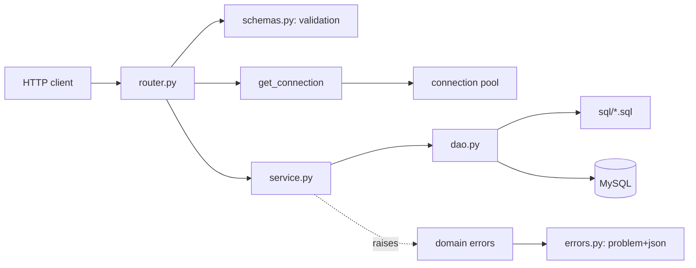

# api-to-sqlite

Fetches 7-day weather forecasts from the [Open-Meteo](https://open-meteo.com/en/docs) API for five West Bank cities, stores them in MySQL, and serves them through a command-line tool and a REST API.

The name comes from the first version, which stored the data in SQLite. The SQLite code was removed after the port to MySQL. The last commit that still has it is tagged `last-with-sqlite`.

The default cities are Ramallah, Nablus, Hebron, Jenin and Jericho. More cities can be added through the API. No API key is needed.

## Setup

Requires Python 3.10 or newer and a MySQL server. It was developed on Python 3.14 and MySQL 8.4. The upsert uses the row-alias form, so use MySQL 8.0.20 or newer. Older versions were not tried.

**1. Create the databases and the user.** Run this as a MySQL admin, and replace `your_password_here` with a password of your own:

```sql
CREATE DATABASE weather CHARACTER SET utf8mb4;
CREATE DATABASE weather_test CHARACTER SET utf8mb4;
CREATE USER 'weather_app'@'localhost' IDENTIFIED BY 'your_password_here';
GRANT ALL PRIVILEGES ON weather.* TO 'weather_app'@'localhost';
GRANT ALL PRIVILEGES ON weather_test.* TO 'weather_app'@'localhost';
```

The tables are created by the tool itself. No schema file needs to be loaded.

**2. Install the project:**

```bash
git clone git@github.com:AbdSh17/api-to-sqlite.git
cd api-to-sqlite
python -m venv .venv
source .venv/bin/activate
pip install -r requirements.txt
pip install -e .
```

`pip install -r requirements.txt` installs the pinned packages. `pip install -e .` makes the `api_to_sqlite` package importable, because the code lives in `src/`.

**3. Configure the connection:**

```bash
cp .env.example .env
```

Open `.env` and fill in the user and the password. `.env` is in `.gitignore`. Never commit it.

## Configuration

Settings are read from the environment and from `.env` in the folder where you run the commands. Run everything from the project root. An environment variable wins over `.env`.

| Variable | Default | Meaning |
|---|---|---|
| `MYSQL_HOST` | `localhost` | MySQL host |
| `MYSQL_PORT` | `3306` | MySQL port |
| `MYSQL_USER` | none, required | MySQL user |
| `MYSQL_PASSWORD` | none, required | MySQL password |
| `MYSQL_DATABASE` | `weather` | Database for the tool and the API |
| `MYSQL_POOL_SIZE` | `5` | Connections in the pool, from 1 to 32 |
| `MYSQL_TEST_DATABASE` | `weather_test` | Database used by the tests. The name must end in `_test` |

A missing or invalid setting stops the tool with one `Error: ...` line and exit code 1. The password is never printed.

## Command-line usage

Run the commands from the project folder, with the virtual environment active.

```bash
python -m api_to_sqlite fetch
python -m api_to_sqlite report
python -m api_to_sqlite report --city ramallah
python -m api_to_sqlite report --csv-dir reports
```

**`fetch`** creates the tables if they are missing and fills an empty `cities` table with the five default cities. It then requests one forecast for each stored city and writes it with an upsert. If a city fails, the tool prints the reason to stderr, skips that city, stores the others and exits with code 1. Running `fetch` again updates existing rows and adds new days. It never creates duplicates.

**`report`** reads the stored data and prints three tables. The reports cover today and later days only. Older days stay in the database but are ignored. If the database has no data, the tool prints a message to stderr and exits with code 1.

| Option | Effect |
|---|---|
| `--city NAME` | Limits all three reports to one city. Letter case is ignored. An unknown city prints an error to stderr and exits with code 1. |
| `--csv-dir DIR` | Also writes `average_max.csv`, `hottest_day.csv` and `rainy_days.csv` into `DIR`. The folder is created if needed. Missing values become empty cells. Works together with `--city`. |

| Exit code | Meaning |
|---|---|
| 0 | Success |
| 1 | A city failed to fetch, `report` found no data, the city given to `--city` is unknown, or the settings or the database connection are wrong |
| 2 | Invalid command-line usage |

### Sample report output

Output of `python -m api_to_sqlite report` for the forecast of 19 to 25 October 2026:

```text
1. Average maximum temperature per city
City      Avg max
--------  -------
Jericho   32.5 C
Jenin     30.4 C
Nablus    27.3 C
Ramallah  24.4 C
Hebron    22.6 C

2. Hottest day per city
City      Date        Max temp
--------  ----------  --------
Jericho   2026-10-23  36.2 C
Jenin     2026-10-23  33.9 C
Nablus    2026-10-24  30.4 C
Ramallah  2026-10-23  27.2 C
Ramallah  2026-10-24  27.2 C
Hebron    2026-10-23  25.3 C

3. Days with rain per city
City      Rainy days
--------  ----------
Hebron    0
Jenin     0
Jericho   0
Nablus    0
Ramallah  0
```

Report 2 shows every day that ties for a city's maximum, which is why Ramallah appears twice. Report 3 lists cities with no rainy days as 0. Rain means `precipitation` above 0, which includes rain, showers and snowfall.

## REST API

Start the server from the project root, with the virtual environment active:

```bash
uvicorn api_to_sqlite.main:app --reload
```

The server stops at startup if MySQL cannot be reached. At startup it also creates the tables and fills an empty `cities` table with the default cities.

The generated documentation is served by the app itself:

| URL | Content |
|---|---|
| `http://127.0.0.1:8000/docs` | Swagger UI, with a "Try it out" button on every endpoint |
| `http://127.0.0.1:8000/redoc` | The same API in a read-only layout |
| `http://127.0.0.1:8000/openapi.json` | The OpenAPI description |

> **Careful:** "Try it out" sends real requests. `POST /v1/cities` adds a city to your database, and `POST /v1/forecast-refreshes` calls Open-Meteo and overwrites stored forecasts.

### Endpoints

| Method | Path | What it does | Success | Errors |
|---|---|---|---|---|
| GET | `/v1/cities` | List the cities | 200 | 503 |
| POST | `/v1/cities` | Add a city | 201 | 409, 422, 503 |
| GET | `/v1/cities/{city}` | One city, by name in any letter case | 200 | 404, 503 |
| GET | `/v1/forecasts` | Daily forecasts, filtered and paged | 200 | 404, 422, 503 |
| GET | `/v1/reports/average-max` | Average maximum temperature per city | 200 | 404, 422, 503 |
| GET | `/v1/reports/hottest-day` | Hottest day per city | 200 | 404, 422, 503 |
| GET | `/v1/reports/rainy-days` | Days with precipitation above 0 per city | 200 | 404, 422, 503 |
| POST | `/v1/forecast-refreshes` | Fetch from Open-Meteo and store | 200, 207 | 502, 503 |
| GET | `/health` | The process is up. No database call | 200 | |
| GET | `/health/ready` | The database answers | 200 | 503 |

### Conventions

- All paths start with `/v1`, except the health endpoints.
- JSON fields use `snake_case`. Units are in the field names: `temp_max_c`, `temp_min_c`, `precipitation_mm`, `avg_max_c`.
- Dates are ISO 8601, for example `2026-10-19`.
- "Today" means the date on the server, in the server's time zone.
- List answers are objects with an `items` array.
- City names in a path or a filter ignore letter case. The stored name is returned.
- There is no authentication.

### Parameters

**`GET /v1/forecasts`** takes `city`, `start_date`, `end_date`, `limit` and `offset`. `start_date` defaults to today, and `end_date` is inclusive. `limit` defaults to 50 and must be from 1 to 200. `offset` defaults to 0. The answer holds `items`, `limit`, `offset` and `total`. `total` counts the matching rows and ignores paging. An `end_date` before `start_date` gives an empty list. Pass an earlier `start_date` to read days that the reports skip.

**The three reports** take `city` and `start_date`, with the same defaults. They have no paging, because each report has one row per city. `rainy-days` shows `0` for a city that has no forecasts yet. That means no data, not no rain.

**`POST /v1/cities`** takes a JSON body with `name`, `latitude` and `longitude`. The name must be 1 to 100 characters, and surrounding spaces are removed. The latitude must be from -90 to 90, and the longitude from -180 to 180. A new city has no forecasts until the next refresh. The answer is `201` with the new city and a `Location` header. A name that exists already, in any letter case, gives `409`.

**`POST /v1/forecast-refreshes`** takes no body. It fetches every stored city from Open-Meteo, stores the forecasts, and waits until it is done. Each Open-Meteo call has a 10 second timeout, so the worst case with five cities is about 50 seconds. The answer lists one result per city. It is `200` when every city is stored, `207` when some cities failed, and `502` when none could be stored. All three answers carry the same `results` body.

### Errors

Errors use `application/problem+json` (RFC 9457), with the fields `type`, `title`, `status`, `detail` and `instance`.

| Status | `type` | When |
|---|---|---|
| 404 | `/problems/city-not-found` | The city in a path or a filter is not stored |
| 409 | `/problems/city-already-exists` | The city name exists already |
| 422 | `/problems/validation-error` | A parameter or a body field is invalid |
| 503 | `/problems/database-unavailable` | The database is down, or no connection became free within 2 seconds. The answer has a `Retry-After: 2` header |
| 500 | `/problems/internal-error` | Any unexpected error. The message is fixed and shows no internal detail |

### Examples

```bash
curl http://127.0.0.1:8000/v1/cities/nablus
```

```json
{"id":2,"name":"Nablus","latitude":32.22,"longitude":35.26}
```

```bash
curl "http://127.0.0.1:8000/v1/forecasts?city=nablus&limit=2"
```

```json
{"items":[{"city":"Nablus","date":"2026-10-19","temp_max_c":23.6,"temp_min_c":15.2,"precipitation_mm":0.0},{"city":"Nablus","date":"2026-10-20","temp_max_c":23.9,"temp_min_c":14.6,"precipitation_mm":0.0}],"limit":2,"offset":0,"total":7}
```

```bash
curl -i http://127.0.0.1:8000/v1/cities/nowhere
```

```text
HTTP/1.1 404 Not Found
content-type: application/problem+json

{"type":"/problems/city-not-found","title":"City not found","status":404,"detail":"No city named 'nowhere'.","instance":"/v1/cities/nowhere"}
```

```bash
curl -i -X POST http://127.0.0.1:8000/v1/cities -H "Content-Type: application/json" -d '{"name":"nablus","latitude":0,"longitude":0}'
```

```text
HTTP/1.1 409 Conflict
content-type: application/problem+json

{"type":"/problems/city-already-exists","title":"City already exists","status":409,"detail":"A city named 'nablus' already exists.","instance":"/v1/cities"}
```

```bash
curl -X POST http://127.0.0.1:8000/v1/forecast-refreshes
```

```json
{"results":[{"city":"Ramallah","status":"stored","days":7},{"city":"Nablus","status":"stored","days":7},{"city":"Hebron","status":"stored","days":7},{"city":"Jenin","status":"stored","days":7},{"city":"Jericho","status":"stored","days":7}]}
```

A failed city in a `207` or `502` answer has the shape `{"city":"Jenin","status":"failed","error":"The service is overloaded"}`. It has an `error` and no `days`.

## Table design

```text
cities                              daily_weather
------                              -------------
id         INT AUTO_INCREMENT PK    city_id        INT NOT NULL, FK to cities(id)
name       VARCHAR(100) UNIQUE      date           DATE NOT NULL
latitude   DOUBLE NOT NULL          temp_max       DOUBLE
longitude  DOUBLE NOT NULL          temp_min       DOUBLE
                                    precipitation  DOUBLE
                                    PRIMARY KEY (city_id, date)
```

- `daily_weather` has one row per city per day. The primary key `(city_id, date)` makes that pair unique.
- `city_id` is a foreign key to `cities(id)`, so a city with forecasts cannot be deleted without deleting them first.
- Dates use the `DATE` type. The three weather columns allow `NULL`, in case the API sends no value for a day.
- Both tables use InnoDB and the `utf8mb4_0900_ai_ci` collation. That collation ignores letter case and accents, so `TULKARM` collides with `Tulkarm` on the `UNIQUE` name.
- Rows are written with an upsert: `INSERT ... AS new_row ON DUPLICATE KEY UPDATE`. The forecast window moves forward by one day, so most dates repeat between runs. The upsert overwrites the overlapping days with the newer forecast and inserts the new day. `INSERT IGNORE` and `REPLACE` are not used, because `REPLACE` deletes and re-inserts the row.
- Every query uses named parameters such as `%(name)s`. User input is never placed in a SQL string. All SQL lives in `.sql` files next to the code that runs it.
- Days that have passed stay in the database. The reports and the default of `GET /v1/forecasts` only look from today on.
- There is no migration tool. The tables are created with `CREATE TABLE IF NOT EXISTS` at startup and by the CLI.

## How it is built



Each domain has the same files, and each file has one job:

| File | Job |
|---|---|
| `router.py` | The URLs. It reads the request, calls the service and returns the answer. No rules and no SQL. |
| `schemas.py` | The JSON shapes, as Pydantic models. FastAPI checks the input against them and builds `/docs` from them. |
| `service.py` | The rules. It turns database errors into named errors and commits after a write. No HTTP and no SQL. |
| `dao.py` | Runs the SQL files on a connection that the caller supplies. It never opens, commits or closes a connection. |
| `models.py` | Plain objects that the service and the DAO share, such as `NewCity`. No HTTP. |
| `exceptions.py` | The named errors of the domain. `errors.py` maps each one to an HTTP answer. |

The command line shares the Open-Meteo code and `refresh()` with the API, and it calls the DAOs directly for the reports.

**The connection pool.** `ConnectionManager` is a singleton that owns one fixed-size pool. If MySQL is unreachable, it retries three times, waiting 1 and then 2 seconds, and it only retries "server not reachable" errors. A request that needs a connection waits up to 2 seconds for a free one. After that it fails, and the API answers `503`. A connection is rolled back before it returns to the pool, so a read can never leave an old snapshot behind.

### Project layout

```text
src/api_to_sqlite/
├── main.py            the FastAPI app: startup, routers, error handlers
├── cli.py             the command-line interface
├── __main__.py        entry point for python -m api_to_sqlite
├── config.py          fixed values: default cities, Open-Meteo URL
├── settings.py        typed MySQL settings from the environment and .env
├── database.py        ConnectionManager, the pool and get_connection
├── sql_loader.py      reads the .sql files and runs them
├── errors.py          error handlers that build the problem+json answers
├── api_docs.py        error answers declared on the generated /docs page
├── cities/            router, schemas, service, dao, models, exceptions, sql/
├── forecasts/         router, refresh_router, schemas, service, dao, models, sql/
├── reports/           router, schemas, service, dao, sql/
├── openmeteo/         client, parse, exceptions
└── health/            router
tests/
├── conftest.py        the test database fixture
├── data/sample_response.json
└── test_*.py
```

## Tests

```bash
pytest
```

The tests need MySQL running and the `weather_test` database from the setup. They never touch the `weather` database.

- **A guard:** the test fixture stops the whole run if the test database name does not end in `_test`.
- **A clean start:** the fixture empties the tables of the test database before each test.
- **No internet:** Open-Meteo is replaced by a fake, and a saved sample response is used for the parsing tests.

The tests cover the parsing, the singleton and the pool wait, the DAOs, the command line, and every endpoint with its error answers. The error handlers have their own tests on a small app with no database.

## Known limits

- **No authentication.** Anyone who can reach the API can call `POST /v1/forecast-refreshes`, which uses the Open-Meteo quota. Each added city adds one call to every refresh.
- **No `PATCH` or `DELETE` for cities.**
- **The refresh waits for the result.** There is no background job. It holds one worker thread until it is done.
- **"Today" is the server's date.** There is no time zone setting.
- **No CORS setup.** A browser page on another origin cannot call the API yet.
- **The pool is not closed explicitly** when the server stops.
- **A connection that dies in the middle of a request is not covered by a test.** A connection that is dead at the time it is borrowed is handled: the pool reconnects, and a failure gives `503`.

## Data source

[Open-Meteo Forecast API](https://open-meteo.com/en/docs). The free tier is for non-commercial use, with fewer than 10,000 calls per day. A `fetch` or a refresh makes one call per stored city, so 5 calls with the default cities.
